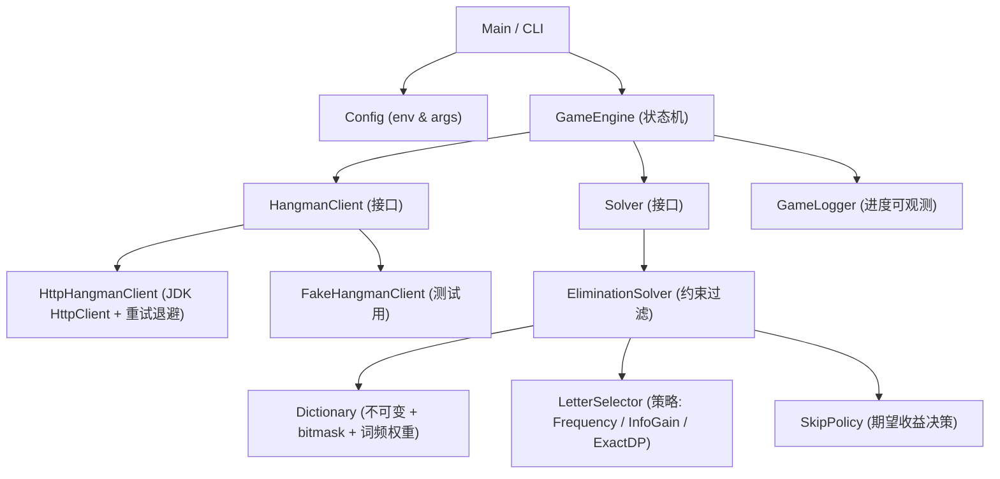

我先加载相关技能规范，同时拉取题目原文和当前仓库实现。

已拿到官方题目原文和仓库现有实现。先说明我的处理方式：

**任务分类：Spike（探针型）** —— 你要的是"我会怎么写 + 与现有实现的优劣对比"，产出是**一份分析与方案建议**，不是要我现在改仓库代码。所以下面只给设计骨架和关键代码片段，**不会落盘、不会动 git**。如果你看完想让我真正实现，我会重新走一次确认流程再动手。

---

# 一、我先把题目"翻译"成工程要求

官方 README 里有几句被大多数人忽略的话，它们才是真正的评分点：

| 原文 | 工程含义 |
|---|---|
| "Good programming practices. Code quality and maintainability" | 分层、可测试、无全局可变状态 |
| "Apply suitable algorithms to solve problems" | 不是"猜字母"，是**约束传播 + 决策最优化** |
| "Creativity" | 要有别人没做的东西（下面第四节） |
| "our server is not made to handle a lot of load... you should handle this case" | **重试/退避/超时是一等公民**，不是补丁 |
| "Be sure to include a README explaining... Walk us through your algorithm" | README 是交付物的一部分 |
| `numberOfWordsToGuess` / `numberOfGuessAllowedForEachWord` 在响应里 | **不要硬编码 80 和 10** |

我还从两个样例反推出了确切计分公式（README 没明说）：

```
78×20 − 234 = 1326   ✓（作者的成绩）
77×20 − 233 = 1307   ✓（官方示例）
```

即 **score = 20 × correctWordCount − totalWrongGuessCount**。这个公式是后面所有策略决策的基础。

---

# 二、我会怎么写

## 2.1 分层：把"网络"和"算法"彻底切开

现有实现最大的结构问题是：HTTP、状态机、算法、统计全塞在一个 579 行的静态类里，**算法无法脱离服务器测试**。我会这样切：



关键点：**`Solver` 完全不知道 HTTP 存在**，输入是 `(谜面 pattern, 错猜次数)`，输出是"下一个字母"。这样我可以写几百个单元测试，还能拿真实对局日志离线回放调参——这在现有实现里做不到。

## 2.2 强类型契约（用 record 代替 `Map<String,Object>`）

现有代码全程用 `Map` 传数据，到处 `.toString()` 和 `Integer.parseInt`，还要靠 `content.put("work", false)` 这种"往数据里塞控制标志"的手法。我会用 record：

```java
public sealed interface Response permits StartGame, WordState, GameResult {}

public record StartGame(String sessionId, int numberOfWordsToGuess,
                        int numberOfGuessAllowedForEachWord) implements Response {}

public record WordState(String word, int totalWordCount,
                        int wrongGuessCountOfCurrentWord) implements Response {
    public boolean solved() { return word.indexOf('*') < 0; }
    public int length()     { return word.length(); }
}

public record GameResult(int totalWordCount, int correctWordCount,
                         int totalWrongGuessCount, int score) implements Response {}
```

编译期就能挡住 `data` 为 null 时的 NPE（错误响应体只有 `message`，现有代码在 `fetchAndSaveResponseParam` 第 451 行 `(Map) content.get("data")` 会直接炸）。

## 2.3 网络层：把官方点名的"服务器会挂"当一等公民

```java
final class HttpHangmanClient implements HangmanClient, AutoCloseable {

    private static final Logger log = System.getLogger(HttpHangmanClient.class);
    private static final Set<Integer> RETRYABLE = Set.of(429, 500, 502, 503, 504);

    private final HttpClient http;
    private final ObjectMapper mapper;
    private final URI uri;
    private final String sessionId;
    private final int maxAttempts;

    private JsonNode post(Map<String, String> body) {
        for (int attempt = 1; ; attempt++) {
            try {
                HttpResponse<String> resp = http.send(request(body), BodyHandlers.ofString());
                if (resp.statusCode() == 200) return mapper.readTree(resp.body());
                if (!RETRYABLE.contains(resp.statusCode()) || attempt == maxAttempts)
                    throw new HangmanApiException(resp.statusCode(), resp.body());
                log.log(WARNING, "HTTP {0}, retry {1}/{2}", resp.statusCode(), attempt, maxAttempts);
            } catch (IOException e) {
                if (attempt == maxAttempts) throw new HangmanApiException("network exhausted", e);
                log.log(WARNING, "IO failure, retry " + attempt, e);
            }
            sleep(backoff(attempt));   // 指数退避 + 抖动
        }
    }

    private static Duration backoff(int attempt) {
        long base = Math.min(1000L << attempt, 30_000L);
        return Duration.ofMillis(base / 2 + ThreadLocalRandom.current().nextLong(base / 2));
    }
}
```

对比现有第 195–197 行：

```java
while (statusCode != 200) { response = httpclient.execute(httpPost); }
```

这是**无退避、无上限、无 close 的死循环**——服务器持续 500 时它会以最高速打对方（相当于自己写了个 DoS），并且每次泄漏一个连接，很快耗尽连接池。官方 Q&A 专门提到这点，我怀疑这是刻意埋的考点。

## 2.4 核心算法：约束完备的过滤 + 位运算

我先说一个让我很满意的化简。在这个游戏规则下（猜中一个字母会翻开**所有**该字母位置），候选词 `w` 合法的充要条件只有两条：

1. 已翻开的位置：`w[i] == pattern[i]`
2. **未翻开的位置：`w[i]` 必须是一个"从未猜过"的字母**

第 2 条一句话就同时覆盖了"不含错猜字母"和"不含已翻开字母"两种约束——因为猜过的字母要么翻开了（那位置 i 也该翻开），要么错了（那位置 i 不可能是它）。所以我不需要维护 `wrongHistory` + `rightGuess` 两套结构：

```java
public final class EliminationSolver implements Solver {

    private final Dictionary dict;
    private final char[] pattern;
    private final boolean[] guessed = new boolean[26];
    private int[] candidates;               // 候选词在 Dictionary 中的下标

    @Override
    public void observe(char letter, WordState state) {
        guessed[letter - 'A'] = true;
        state.word().getChars(0, pattern.length, pattern, 0);
        candidates = filter(candidates);
    }

    private int[] filter(int[] in) {
        int[] out = new int[in.length];
        int n = 0;
        for (int idx : in) if (matches(dict.wordAt(idx))) out[n++] = idx;
        return Arrays.copyOf(out, n);
    }

    private boolean matches(String w) {
        for (int i = 0; i < w.length(); i++) {
            char c = w.charAt(i);
            if (pattern[i] == '*') { if (guessed[c - 'A']) return false; }
            else if (pattern[i] != c) return false;
        }
        return true;
    }
}
```

注意：**候选集是 `int[]` 下标数组，不是 `List<String>`**。过滤是"从旧数组筛出新数组"，原始 `Dictionary` 永远不可变。这解决了现有实现里"每猜一个新词都要用 `initDictionary()` 把 46 万个词重新塞一遍"的问题（因为它是直接 `remove` 全局字典的元素，把数据破坏了，只能重建）。

`Dictionary` 预计算：

```java
public final class Dictionary {
    private final String[] words;
    private final int[] masks;                  // 26-bit 字母集合，过滤时可先用位运算粗筛
    private final int[] weights;                // 词频权重（关键，见 4.2）
    private final Map<Integer, int[]> byLength; // 长度 -> 下标数组，建库时一次分桶
}
```

有了 `byLength`，"按谜底长度取候选"就是 O(1) 查表，而不是像现有代码那样把长度过滤条件 `s.length() != word.length()` 塞进 `removeLatestWrongGuess` 里、导致**第一次猜就命中时长度过滤根本不执行**（第 255 行 `if (wrongHistory.size() > 0)` 才调用）。

## 2.5 选哪个字母：从"频率贪心"升级到"期望损失最小"

现有实现选"候选集中出现次数最多的字母"。这其实是**最小化单次 miss 概率的贪心**——方向对，但没考虑后续。我会做三档，按候选集规模自动切换：

```java
char selectLetter(int[] cands) {
    if (cands.length <= EXACT_THRESHOLD) return exactDp(cands);   // ≤12：精确最优
    return greedy(cands);                                          // 大规模：加权贪心 + 信息增益破平
}

// 贪心：cost(c) = P(miss) × 罚分 + λ × 猜完后的期望不确定性
private char greedy(int[] cands) {
    int total = sumWeights(cands);
    char best = '?'; double bestCost = Double.MAX_VALUE;
    for (char c = 'A'; c <= 'Z'; c++) {
        if (guessed[c - 'A']) continue;
        int hitW = 0, hitN = 0, missN = 0;
        for (int idx : cands) {
            boolean has = (dict.maskAt(idx) & (1 << (c - 'A'))) != 0;
            if (has) { hitW += dict.weightAt(idx); hitN++; } else missN++;
        }
        double pHit = (double) hitW / total;
        double uncertainty = pHit * log2(Math.max(hitN, 1)) + (1 - pHit) * log2(Math.max(missN, 1));
        double cost = (1 - pHit) * 1.0 + LAMBDA * uncertainty;
        if (cost < bestCost) { bestCost = cost; best = c; }
    }
    return best;
}
```

`exactDp` 是小候选集上的精确解，直接最小化期望错猜次数：

\[
f(S) = \min_{c}\Big[ p_{\text{hit}}(c)\cdot f(S_{\text{hit}}) + p_{\text{miss}}(c)\cdot\big(1 + f(S_{\text{miss}})\big)\Big]
\]

带记忆化，\(S\) 用候选集的 bitmask 表示。**这一步是现有实现完全没有的**，也是我认为能明显拉开分差的地方：候选集缩到十几个词时，贪心经常会走一条"看着命中率高但把局面劈成两半都很烂"的路，DP 不会。

## 2.6 状态机：`switch` 表达式而不是 145 行的 if-else 链

```java
public GameResult play(String playerId) {
    StartGame game = client.startGame(playerId);
    log.log(INFO, "session={0}, words={1}, missesAllowed={2}",
            game.sessionId(), game.numberOfWordsToGuess(), game.numberOfGuessAllowedForEachWord());

    while (true) {
        WordState ws = client.nextWord();
        Solver solver = solverFactory.create(ws.length());
        log.log(INFO, "word #{0} length={1}", ws.totalWordCount(), ws.length());

        while (!ws.solved()) {
            int left = game.numberOfGuessAllowedForEachWord() - ws.wrongGuessCountOfCurrentWord();
            if (left == 0 || skipPolicy.shouldSkip(solver, left)) break;   // 见 4.3
            char g = solver.nextGuess();
            ws = client.guess(g);
            solver.observe(g, ws);
        }
        if (ws.totalWordCount() >= game.numberOfWordsToGuess()) break;
    }
    return client.submitResult();
}
```

`skipPolicy.shouldSkip` 是我认为**现有实现漏掉的一个真实决策点**，下面细说。

---

# 三、与现有 `HangmanPlayer.java` 的对比

## 3.1 它做对了什么（不吹不黑，这几点是真优点）

1. **算法主干是正确的**：候选集过滤 + 剩余词字母频率统计，这就是 Hangman 求解的主流最优思路。很多应聘者只会背 `EAOIUT...` 静态词频表，那个上限低得多。
2. **按题目难度区间分了 A/B/C/D 四级词库**，且分级边界与官方规则严格对应。
3. **有降级策略**：候选集空了退回静态词频表。考虑到了"谜底不在我词库里"这个必然会发生的场景。
4. **认识到了词库规模是最大杠杆**，并做了实证（4600 → 8000 → 6万 → 46万，分数 700 → 900 → 1326）。这个"用数据驱动决策"的过程写在 README 里，正好命中官方 "Walk us through your algorithm" 的要求，**是这份提交里最有说服力的部分**。
5. **README 的完整度远超平均水平**：背景、规则、算法描述、知识点、自我批判（第 80 行主动承认异常处理有问题）都有。自我批判这一点在面试里是加分项。
6. 1326 分 vs 官方平均 1000 分、示例最高 1307 分——**结果是硬的，超过了官方示例**。

## 3.2 它的问题

### A. 正确性 bug（会实际影响分数）

| # | 位置 | 问题 |
|---|---|---|
| A1 | 255–257 行 | 长度过滤 `s.length() != word.length()` 被放在 `if (wrongHistory.size() > 0)` 里面。**第一次猜 E 就命中时，长度过滤不执行**，候选集混入长度不符的词，字母频率统计从第一轮就是错的 |
| A2 | 382–384 行 | 靠 `catch (StringIndexOutOfBoundsException)` 删短词——用异常做控制流，且**长词永远删不掉**（`charAt` 不越界）。A1 的漏洞在这里也没被补上 |
| A3 | 344–347 行 | `characters.clear()` 在 `countCharacterByLetter` 内部，但该方法只在 `suitableDictionary.size() > 0` 时才被调用（269 行）。**候选集一空，就会拿上一个词残留的字母频率表来猜**——跨词状态污染 |
| A4 | 102–106 / 285 行 | `lettersByFrequency` 是静态 `CopyOnWriteArrayList`，靠 `initLetter()` 往里 **add**、靠 `removeAll(guessHistory)` 破坏性删。`initLetter()` 在 `nextWord` 和 `createActionByTotalWordCount` 两处都被调用，一旦调用路径不匹配就会**重复累加字母**，降级策略可能猜出已经猜过的字母 |
| A5 | 287 行 | 26 个字母全猜过后 `lettersByFrequency.get(0)` → `IndexOutOfBoundsException`，没有兜底 |
| A6 | 246 行 | `word.contains(lastGuess)` 判断命中。若因为 A4 重复猜了同一字母，翻开的 word 里仍含该字母 → 被误判为"又一次命中"，`rightGuess` 被覆盖，过滤逻辑随之错乱 |
| A7 | 309 行 | `totalWordCount == 80 ? ACTIONS[4] : ACTIONS[1]` 用了魔法数字 80，而上面明明定义了 `NUMBER_OF_WORDS_TO_GUESS`。两处不一致时行为静默出错 |

### B. 工程质量（这是官方明确列出的评分维度）

| # | 问题 |
|---|---|
| B1 | **全部状态都是 `static` 可变字段**（69–82 行），`main` 里直接跑流程。没有接缝 → **算法无法单元测试**。整个仓库 0 个测试文件、0 个测试依赖 |
| B2 | **第 368–370 行反射读 `LinkedHashMap.tail` 私有字段**。这在 JDK 9+ 的模块系统下会抛 `InaccessibleObjectException`（`java.base` 不 open `java.util`）。你当前环境是 **JDK 25**，这段代码原样跑不起来。而且注释说"时间复杂度最低 o(1)"完全站不住——记一个 `lastRightLetter` 变量就是 O(1)，不需要反射。这是典型的**用奇技淫巧替代简单设计**，在面试里是减分项而不是加分项 |
| B3 | `perform()` 单方法 145 行、5 个 action 分支混在一起，圈复杂度极高，改一处要通读全文 |
| B4 | `fetchAndSaveResponseParam()`（448–488 行）7 个 `if (data.get(x) != null)` 平铺，裸类型 `Map data`，把"解析响应"和"往同一个 map 里回写字段"混为一谈 |
| B5 | `ACTIONS[0]`…`ACTIONS[4]` 数组下标引用，应该用 `enum Action` |
| B6 | `SERVER_URL`、`PLAYER_ID`（含真实 QQ 邮箱）硬编码在源码常量里，无法在不改代码的情况下换环境/换账号 |
| B7 | 用 `StringBuffer`（同步）在单线程程序里，且作为全局可变字段 `sb` 复用；`CopyOnWriteArrayList` 用于**根本没有多线程**的场景（作者在 README 第 81 行也承认没写多线程）——并发容器的误用 |
| B8 | `content.put("work", false)` 把控制流标志塞进数据 map，`while(work)` 在主循环里读 |
| B9 | `pom.xml` 的 `groupId` 是 `com.strikingly.game`，包名却是 `com.wangyousong.game.hangman`；`source/target 1.8` 与本机 JDK 25 不匹配；根目录无 `.gitignore`，`.idea/workspace.xml` 入了库 |
| B10 | 全靠 `e.printStackTrace()`，没有日志级别、没有进度输出。**跑 86 分钟全程黑盒**，无法观测、无法定位是哪一类词拖了分 |

### C. 健壮性

- 第 195–197 行的无退避无上限死循环 + response 不 close 导致连接泄漏（前面已详述）。
- 第 168 行 `finally { httpclient.close(); }`：若 `createDefault()` 之前就抛异常，`httpclient` 为 null → NPE 覆盖原始异常。
- 没有区分 4xx（不该重试，是程序 bug）和 5xx（该重试），一律重试。
- `perform()` 的 `catch (Exception e)` 吞掉一切后返回旧 `content`，主循环拿着过期状态继续跑。

### D. 性能（86 分钟的成因，可量化）

| # | 位置 | 代价 |
|---|---|---|
| D1 | 用 `CopyOnWriteArrayList` 且在 for-each 中 `remove`（375–401 行） | COW 每次 remove 复制整个底层数组 → **O(n²)**。n=46 万时，这是分钟级甚至小时级的开销。而且遍历的是旧快照，语义隐晦。普通 `ArrayList` 这样写会抛 `ConcurrentModificationException`，用 COW 只是把崩溃换成了极慢 |
| D2 | 375–386 行嵌套循环内重复 `remove(s)` | 一个词可能因多个 index 被删多次 → 多次全数组复制 |
| D3 | 108–129 行 `initDictionary()` | 每个新词都重建全部 4 级字典：46 万 × 80 = **3680 万次 add**。而它必须重建，正是因为 D1 破坏了全局数据 |
| D4 | 347–350 行 | 把整个候选集 `append` 成一个 4MB+ 的巨型字符串，再连续 3 次 `replace` 各生成一个新字符串——**每猜一个字母做一次**。直接双重循环统计即可，零分配 |
| D5 | 528–529 行 | `for (int i = 0; i < s.toCharArray().length; i++)` 且循环体内又调 `s.toCharArray()[i]` → **每轮迭代新建 2 个数组**，GC 压力爆炸 |

用 `int[]` 下标 + bitmask + `int[26]` 计数替换以上全部，我估计能把 86 分钟压到**几分钟**量级（词库加载和过滤都是纯数组扫描，零对象分配）。

---

# 四、真正能拉开分差的三个点（"Creativity" 维度）

## 4.1 多 session 并行 + 择优提交

官方说 "You can play and submit as many times as you want, but we only store the **LATEST** submitted score"。这意味着：

- 开 N 个 session 并行跑（词库是只读的，天然线程安全）
- **只 `getResult` 不 `submitResult`**，比较分数
- 只对最高分那局调 `submitResult`

现有实现是单线程串行、且跑到第 80 词无条件提交。改成并行 + 择优，等于**用同样的算法把期望分数从"单次抽样"提升到"N 次抽样的最大值"**——按作者自述"最高 1326、平均 700 左右"，方差极大，这一招的收益可能比调算法还大。这是我认为最被低估的改进。

## 4.2 词频加权，而不是"词库越大越好"

作者的结论是"词库量的重要性"，46 万词拿到 1326 分。但我认为这个结论**只对了一半**：

大词库提升了"谜底在库内"的覆盖率，但同时引入了大量生僻词，它们会**污染候选集**——真实谜底是 `APPLE`，但候选集里混进 `APPLYING`、`APPALLING` 等一堆同前缀生僻词，字母频率统计被带偏，反而多错猜。

正确做法是**加权而非等权**：给每个词一个先验权重（来自 Google Books / SUBTLEX 词频表），候选集的概率分布为

\[
P(w) = \frac{\text{freq}(w)}{\sum_{v \in S}\text{freq}(v)}
\]

然后 \(p_{\text{hit}}(c) = \sum_{w \ni c} P(w)\)。这样既保留大词库的覆盖率，又让常见词主导决策。同时可以把"词库外兜底"的静态词频表也换成同一套加权数据，逻辑统一。

## 4.3 Skip 决策：作者的直觉结论其实不严谨

README 第 22 行作者论证"最好不要跳过"，用了个"1000 分保底"的假想例子。但他漏了一件事：**10 次错猜用完还没猜出，是 −10 分，不是 0 分**。而 skip 是 0 分。

用 `score = 20×correct − wrong` 算期望（设猜出时平均错猜 \(k\) 次，成功率 \(p\)）：

\[
EV_{\text{continue}} = p(20-k) - (1-p)\cdot 10 = p(30-k) - 10
\]

\[
EV_{\text{skip}} = 0
\]

取 \(k \approx 4\)，则 \(EV_{\text{continue}} > 0 \iff p > \frac{10}{26} \approx 0.385\)。

**结论**：成功率高于约 38.5% 就该继续猜，低于就该 skip。作者的"永远不 skip"在大多数情况下是对的（长词、大词库时 \(p\) 通常很高），但在**短词阶段（1–20 词，作者自己也说"单词越短越难猜"）且错猜配额只剩 1–2 次**时，\(p\) 会掉到阈值以下，此时硬猜是净亏损。

我会实现一个 `SkipPolicy`：

```java
boolean shouldSkip(Solver solver, int guessesLeft) {
    double p = solver.probabilityOfSolvingWithin(guessesLeft);  // 由候选集规模 + 加权分布估算
    double ev = p * (CORRECT_REWARD - solver.expectedMisses(guessesLeft))
              - (1 - p) * guessesLeft;                          // 最坏情况扣满剩余配额
    return ev < 0;
}
```

其中 `probabilityOfSolvingWithin(r)` 可用候选集大小 \(n\) 近似：每步命中率约 \(1/n\) 量级递减，\(r\) 步内解出的概率 \(\approx 1-(1-\bar p)^r\)。这个决策不需要很精确，**只要在明显该跑的时候跑掉**就能挽回分数。

顺带说：这个 EV 分析写进 README，比"我觉得不该跳过"有说服力得多——官方要的就是 "Walk us through your algorithm"。

---

# 五、总评对比表

| 维度 | 现有 `HangmanPlayer.java` | 我的方案 |
|---|---|---|
| 算法主干 | ✅ 候选集过滤 + 频率贪心（正确） | ✅ 同样思路 + 小候选集精确 DP + 词频加权 |
| 约束建模 | ⚠️ `wrongHistory`/`rightGuess` 双结构，只处理"最新一条"，靠历史累积，脆弱 | ✅ 一个 `guessed[26]` + `pattern[]`，充要条件完备 |
| 可测试性 | ❌ 全 static，0 测试 | ✅ `Solver`/`Client` 均为接口，可离线回放、可单测 |
| 健壮性 | ❌ 无退避死循环 + 连接泄漏 + 吞异常 | ✅ 指数退避、重试上限、区分 4xx/5xx、结构化日志 |
| JDK 兼容性 | ❌ 反射 `LinkedHashMap.tail`，JDK 9+ 直接抛异常 | ✅ 纯公开 API，JDK 17/21/25 均可 |
| 性能 | ❌ COW + O(n²) remove + 每词重建字典 → 86 分钟 | ✅ 不可变字典 + `int[]` 下标 + bitmask → 分钟级 |
| 配置化 | ❌ URL / playerId 硬编码 | ✅ env / CLI |
| 得分策略 | ⚠️ 永不 skip（结论不严谨）；单局串行提交 | ✅ EV 驱动 skip；多 session 并行择优提交 |
| 最终成绩 | ✅ **1326 分，超过官方示例 1307** | 未知，但结构上支持持续调优 |
| README | ✅ 详尽、有实证过程、有自我批判 | 需另写 |

**一句话总结**：现有实现在**"拿到高分"这个结果上很成功**（1326 > 官方示例），算法直觉也对；但在官方明确列出的另外三个评分维度——**代码质量、可维护性、良好编程实践**——上失分严重：全局可变静态状态、反射侵入 JDK 内部、`CopyOnWriteArrayList` 掩盖 `ConcurrentModificationException`、零测试、无退避的重试死循环。如果我是 Strikingly 的面试官，这份提交会让我**怀疑分数的可持续性，但认可作者的钻研能力**——README 里那段词库规模的实证迭代是最打动人的部分。

我的方案在算法上限（DP + 加权 + skip + 并行择优）和工程质量上都更高，但**没有跑出来的分数**就只是纸上谈兵——这也是为什么作者那份"1326 分"依然有它的分量。

---

# 六、下一步

要不要我把它真正落地？如果要做，我建议按这个顺序，你选一个：

- **A. 只重构，不换算法**：把 `HangmanPlayer` 拆成 `Client`/`Solver`/`Engine`，修掉 A1–A7 和 B2（反射）、C（重试），补单测。风险最低，能验证"同样的算法在正确实现下能跑多快"。
- **B. 重构 + 算法增强**：在 A 之上加词频加权、小候选集 DP、skip 策略。
- **C. 加并行择优**：在 B 之上加多 session 并发跑、择优 submit。
- **D. 先只做离线验证**：不碰网络，写一个本地 Hangman 服务端模拟器（用 words.txt 出题），这样可以**无成本、可重复地对比不同策略的分数**，调好参数再上真服务器。

我个人推荐 **D → A → B → C** 的顺序：先有可重复的评测环境，再谈优化，否则每次验证都要等一小时。

⚠️ 另外提醒一个现实问题：**官方服务器 `strikingly-hangman.herokuapp.com` 是 2014 年的 herokuapp 域名，现在极可能已经下线**，URL 也是从邀请邮件里取的。所以 D 方案（自建模拟器）几乎是必选项。

告诉我选哪个，我会先出设计再动手；涉及 git 提交我会先跟你说明目的并征得同意。